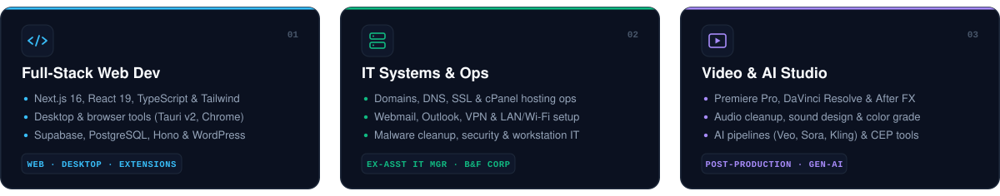

  

> Engineering clean full-stack software, dependable business IT infrastructure, and high-retention post-production & AI creative workflows from **Chattogram, Bangladesh**.

- **Currently building:** Editorial & interactive web apps (`Next.js 16` + `Supabase` + `WebGL`), Premiere Pro CEP automation (`KahamaticPRO`), and lightweight browser productivity extensions.
- **Crossover focus:** Bridging code and media — building tools like an Apple Silicon Swift 6 + Gemini AI extension directly for my own video editing pipeline.
- **Experience:** Former **Assistant IT Manager & Video Editor** at B&F Corporate, **Front-end Developer** at Velocity Digital Inc., and **WordPress Developer** at JobMatchingBD.com.
- **Education:** BSc in Computer Science & Engineering (Major: Web Development), Port City International University.

 

  

### Core Disciplines

  

 

  

### Featured Production Builds

<table>
  <tr>
    <td width="50%" valign="top">
      <strong><a href="https://github.com/kamru1i/KahamaticPRO">KahamaticPRO</a></strong> · <em>Premiere Pro Extension</em>  
      Dark-theme Adobe Premiere Pro CEP extension combining named version backups, native Apple Silicon DSP auto-cuts (<code>Swift 6</code> / <code>Accelerate</code>), and Gemini AI scene workflows.  
      <code>Svelte 5</code> <code>TypeScript</code> <code>Swift 6</code> <code>Tailwind v4</code> <code>Gemini AI</code>
    </td>
    <td width="50%" valign="top">
      <strong><a href="https://github.com/kamru1i/portfolio">portfolio</a></strong> · <a href="https://kamrulislam.me"><strong>Live Site ↗</strong></a>  
      Editorial dark-mode personal platform with WebGL shader curtain transitions, Lenis smooth scroll, Hono API gateway, Supabase CMS, and Playwright QA.  
      <code>Next.js 16</code> <code>React 19</code> <code>TypeScript</code> <code>Hono</code> <code>Supabase</code>
    </td>
  </tr>
  <tr>
    <td width="50%" valign="top">
      <strong><a href="https://github.com/kamru1i/cross-poster">cross-poster</a></strong> · <em>Creator Publishing Studio</em>  
      Open-source self-hosted, multi-tenant social publishing studio for cross-posting, post scheduling, analytics, and simultaneous RTMP live streaming.  
      <code>Next.js</code> <code>TypeScript</code> <code>Prisma</code> <code>RTMP</code> <code>BYOK</code>
    </td>
    <td width="50%" valign="top">
      <strong><a href="https://github.com/kamru1i/qc-manager-app">qc-manager-app</a></strong> · <em>Desktop, Web &amp; Mobile</em>  
      Offline-first corporate operations suite uniting an Employee Leave Tracker and Quotes &amp; Sales workflow with native system tray and RBAC sync.  
      <code>Next.js 16</code> <code>Tauri v2</code> <code>Rust</code> <code>Capacitor</code> <code>Supabase</code>
    </td>
  </tr>
  <tr>
    <td width="50%" valign="top">
      <strong><a href="https://github.com/kamru1i/Teletalk-Jobs-Filler">Teletalk-Jobs-Filler</a></strong> · <em>Chrome Extension MV3</em>  
      Zero-cloud, local-storage Chrome extension that smartly autofills Bangladesh Government Job portals (<code>*.teletalk.com.bd</code>) with multi-profile JSON backup.  
      <code>Manifest V3</code> <code>JavaScript</code> <code>DOM Automation</code> <code>Strict CSP</code>
    </td>
    <td width="50%" valign="top">
      <strong><a href="https://github.com/kamru1i/photocard">photocard</a></strong> · <a href="https://photocard-five.vercel.app"><strong>Live App ↗</strong></a>  
      Client-side branded delivery card generator built on HTML5 Canvas with pan/zoom framing, photo enhancement presets, and lossless PNG export.  
      <code>TypeScript</code> <code>HTML5 Canvas</code> <code>Tailwind CSS</code> <code>Vercel</code>
    </td>
  </tr>
</table>

 

  

### Tech Stack &amp; Production Toolchain

<table>
  <tr>
    <td width="24%"><strong>Web &amp; Apps</strong></td>
    <td>
      
      
      
      
      
      
      
      
    </td>
  </tr>
  <tr>
    <td><strong>Backend, Data &amp; QA</strong></td>
    <td>
      
      
      
      
      
      
      
      
    </td>
  </tr>
  <tr>
    <td><strong>IT, Hosting &amp; Ops</strong></td>
    <td>
      
      
      
      
      
      
    </td>
  </tr>
  <tr>
    <td><strong>Video &amp; AI Media</strong></td>
    <td>
      
      
      
      
      
    </td>
  </tr>
</table>

 

  

### Activity &amp; Engineering Telemetry

  
  

   
  

 

  
    
  
    Open to web engineering, IT infrastructure, and creative post-production collaborations —
    <a href="https://kamrulislam.me/contact-us"><strong>kamrulislam.me/contact-us</strong></a> ·
    <a href="mailto:hello@kamrulislam.me"><strong>hello@kamrulislam.me</strong></a>
  

